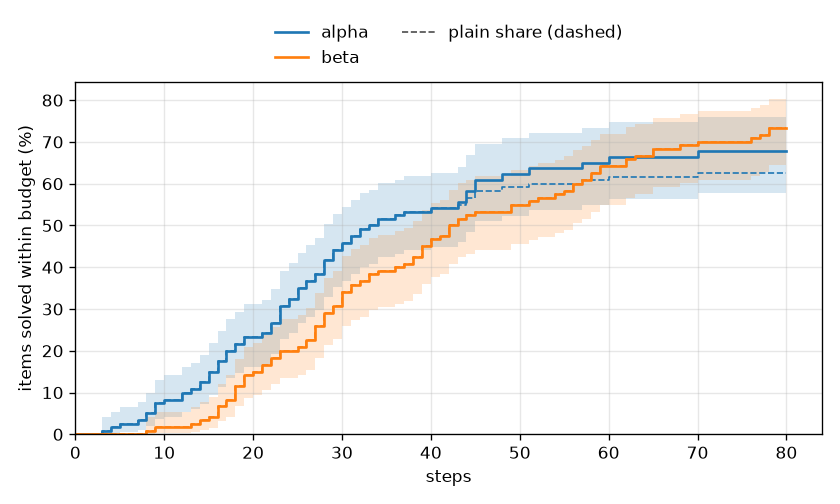
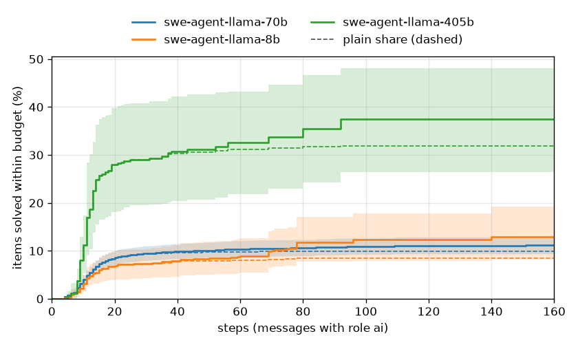

# stepbudget

From agent runs with their outcome and the steps (or tokens, cost, time) each one used, stepbudget
estimates the success rate as a function of the budget allowed, treating runs that were stopped by
the limit as censored, and compares systems at equal budgets.

## Why this is hard

A run stopped by the limit says only that solving the item would have needed more than the budget
it used. Dropping such runs over-represents the runs that ended early, and counting them as
failures at every larger budget understates what a larger limit would have scored; both bias the
curve as soon as runs were stopped at different budgets. Systems that were run under different
limits cannot be compared by their headline scores. And the steps a failed run spends before it
ends are not the steps it would have needed to succeed, so a run that ended unsolved on its own
has to be kept apart from a run the limit cut off.

## Install

    pip install git+https://github.com/vipul21435/stepbudget

The chart needs matplotlib as well (`pip install matplotlib`, or the `plot` extra). Python 3.10
or later; the only runtime dependency is numpy.

## Quickstart

`examples/runs.csv` holds 240 synthetic runs of two made-up systems on 120 items (written by
`examples/make_runs.py`; "alpha" was run under a limit of 40 steps on half the items and 80 on the
rest, "beta" under 80 everywhere).

    stepbudget curve examples/runs.csv --system alpha --budgets 20 40 60 80

```
## alpha

120 runs on 120 items: 75 succeeded, 26 ended unsolved before the limit, 19 (15.8 % of runs) were stopped by the limit.

| budget | solved within budget | 95 % interval | plain share | still running | runs past budget |
| --- | --- | --- | --- | --- | --- |
| 20 | 23.3 % | 16.2 to 31.2 % | 23.3 % | 65.8 % | 79 |
| 40 | 54.2 % | 44.8 to 62.6 % | 54.2 % | 25.8 % | 19 |
| 60 | 66.4 % | 56.3 to 74.7 % | 61.7 % | 12.2 % | 9 |
| 80 | 67.8 % | 57.7 to 75.9 % | 62.5 % | 9.5 % | 0 |

Interval: delta-method variance. The first run stopped by the limit had used 40. The two curves are the same below 43 and differ from there on: the plain share counts every run stopped earlier as unsolved at every larger budget, while the censoring-aware curve lets the runs still going stand in for it.
```

What other limits would have scored (output shortened to the table):

    stepbudget at examples/runs.csv --system alpha --budgets 20 40 60 120

```
As run: 62.5 % of items solved, 15.8 % stopped by the limit, largest budget used 80.

| limit | solved | how | if no stopped run solves | if every stopped run solves | 95 % interval |
| --- | --- | --- | --- | --- | --- |
| 20 | 23.3 % | by truncation | 23.3 % | 23.3 % | 16.2 to 31.2 % |
| 40 | 54.2 % | by truncation | 54.2 % | 54.2 % | 44.8 to 62.6 % |
| 60 | 66.4 % | censoring-aware estimate | 61.7 % | 71.7 % | 56.3 to 74.7 % |
| 120 | 73.1 % | extrapolation | 62.5 % | 78.3 % | - |
```

Two systems at equal budgets:

    stepbudget compare examples/runs.csv --budgets 20 40 60 80

```
## alpha against beta

120 items run by both systems; difference is alpha minus beta; 95 % interval from a paired bootstrap over items (1000 replicates, seed 0).

| budget | alpha | beta | difference | 95 % interval | replicates with alpha ahead |
| --- | --- | --- | --- | --- | --- |
| 20 | 23.3 % | 15.0 % | +8.3 points | +0.8 to +17.5 | 97.8 % |
| 40 | 54.2 % | 46.7 % | +7.5 points | -3.3 to +17.5 | 92.4 % |
| 60 | 66.4 % | 64.2 % | +2.2 points | -7.3 to +12.7 | 68.0 % |
| 80 | 67.8 % | 73.3 % | -5.6 points | -14.4 to +4.3 | 12.5 % |

Log-rank test on the budget to success: chi-square 6.904 on 1 degree of freedom, p = 0.0086 (alpha had 75 successes against 59.3432 expected if both succeeded at the same rate among runs still going). The test treats runs as independent.
Lead changes: alpha is ahead first, then beta from 63 (curves compared up to budget 80).
beta is ahead at budget 80 in 87.4 % of the bootstrap replicates.
```

Marginal return and cost of a success (headings omitted):

    stepbudget marginal examples/runs.csv --system alpha --step 20
    stepbudget cost examples/runs.csv --system beta --limits 20 40 80

```
| limit raised from | solved share gained | successes per 100 items per unit of limit | successes per 100 units actually spent |
| --- | --- | --- | --- |
| 0 to 20 | +23.33 points | 1.17 | 1.36 |
| 20 to 40 | +30.83 points | 1.54 | 3.7 |
| 40 to 60 | +12.24 points | 0.612 | 3.3 |
| 60 to 80 | +1.36 points | 0.068 | 0.641 |

From budget 60 on, each further unit of limit adds fewer than 0.1 successes per 100 items.
```

```
| limit | solved | spent per item | spent per solved item | 95 % interval |
| --- | --- | --- | --- | --- |
| 20 | 15.0 % | 19.28 | 128.6 | 88.31 to 212.6 |
| 40 | 46.7 % | 32.48 | 69.59 | 56.82 to 88.3 |
| 80 | 73.3 % | 45.63 | 62.22 | 52.67 to 75.1 |

As run: 45.62 spent per item, 73.3 % solved, 62.22 per solved item. Interval: bootstrap over items (1000 replicates, seed 0).
```

Every command takes `--format json`. `stepbudget curve ... --plot FILE` also draws the curves
(solid: censoring-aware curve with its band; dashed: plain share):

    stepbudget curve examples/runs.csv --plot docs/example_curves.png --xlabel steps



The same from Python is in `examples/quickstart.py`.

## Input

One row per run, as CSV or JSON lines (`.jsonl`, `.ndjson`):

| column | meaning | flag to rename |
| --- | --- | --- |
| `item` | the item the run was on | `--item-col` |
| `system` | the system that ran (optional) | `--system-col` |
| `outcome` | success or failure (`true`/`false`, `1`/`0`, `success`, `resolved`, ...) | `--outcome-col` |
| `budget` | steps, tokens, cost or time the run used | `--budget-col` |
| `exit_reason` | how the run ended (optional) | `--exit-col` |

A successful run is a success at the budget it used. A failed run is "stopped by the limit" when
its exit reason is one of `--limit-reasons` (default
`limit reached,limit,limit_reached,max_steps,timeout`) or, with `--limit L`, when it used at least
`L`. Every other failed run "ended unsolved before the limit"; that class is defined by the exit
reason alone and includes errors. A file with several budget columns (steps and cost, say) is
analysed on one of them at a time with `--budget-col`; `stepbudget cost --second-col NAME` also
totals a second column per solved item as run. A `.json` file holding one array of such objects
is read too.

## How it works

**The curve.** Let `t_1 < t_2 < ...` be the distinct budgets at which runs ended, `n_i` the number
of runs still going just before `t_i`, and `s_i` and `g_i` the numbers that succeed and that end
unsolved on their own at `t_i`. Runs stopped by the limit leave the risk set without an event.

    running(t) = prod over t_i <= t of (1 - (s_i + g_i) / n_i)
    solved(t)  = sum  over t_i <= t of running(t_{i-1}) * s_i / n_i

`running` is the product-limit estimator of Kaplan and Meier (1958) applied to "the run has
ended on its own", and `solved` is the cumulative incidence of success with ending unsolved as a
competing event, the competing-risks case of the estimator of Aalen and Johansen (1978). Treating
the unsolved endings as censored instead (one minus Kaplan-Meier on success) would answer a
different question: the success rate if no run ever ended on its own.

**Intervals.** With one run per item the variance of `solved(t)` is the delta-method estimate,
which reduces to Greenwood's formula `S(t)^2 * sum d_i / (n_i (n_i - d_i))` when there is no
competing event; the interval is formed on the log(-log) scale so it stays inside 0 to 1. The
tests compare the estimate and its variance with the lifelines package. The intervals are
pointwise, not a band for the whole curve.

**The plain share** is the number of runs that succeeded within the budget divided by all runs.
It equals the censoring-aware curve up to the first budget at which a run was stopped by the
limit, stays equal until a run succeeds at a larger budget, and is lower from then on. If every
run had the same limit and none was stopped earlier, the two are the same everywhere; the
censoring-aware curve matters when runs were stopped at different budgets (mixed limits, or a
limit on another quantity such as cost or time that falls at a different step count in each run).

**Repeated runs.** A run of an item that was run `k` times gets weight `1/k`, so the curve is a
share of items. Intervals then come from a bootstrap that draws items with replacement and takes
all runs of a drawn item together (percentile interval, `--boot` replicates, `--seed`).

**Another limit.** For a limit `b`, the share of items with a success within `b` is a lower
bound ("no stopped run solves") and adding every run stopped before `b` gives an upper bound
("every stopped run solves"). When no run was stopped before `b` the two coincide and the score
is exact by truncation. Otherwise the curve gives an estimate between them. Beyond the largest
observed budget `L` the tool extrapolates, and says so: with `a` and `g` the successes and
unsolved endings per unit of budget spent over the last `--tail` fraction of the observed range
(default one half) and `R = running(L)`,

    solved(b) = solved(L) + R * a / (a + g) * (1 - exp(-(a + g) * (b - L)))

which assumes those rates stay constant. Only the bounds are supported by the data.

**Comparison.** `compare` uses the items both systems ran. The difference of the two curves at
each budget gets a percentile interval from a paired bootstrap: items are drawn with replacement
and each brings its runs of both systems. The log-rank test (Mantel 1966) is computed on the
budget to success, with every other ending removed from the risk set; it compares the rate of
success among runs still going. Lead changes are the budgets at which the sign of the difference
flips, over the range both curves cover.

**Marginal return.** Between two limits `b1 < b2` the gain is `solved(b2) - solved(b1)`. Divided
by `b2 - b1` it is the success gained per unit of limit; divided by the budget actually spent in
between, `integral from b1 to b2 of running(u) du`, it is the success per unit spent, since only
runs still going spend it. `--threshold` names the budget from which the first stays below it.

**Cost of a success.** The expected budget a run uses under limit `b` is
`integral from 0 to b of running(u) du`; divided by `solved(b)` it is the budget spent per solved
item, with the budget burned by unsolved runs charged to the solved ones. When no run was stopped
before `b` this is exactly the sum of `min(budget used, b)` over runs divided by the number of
successes within `b`.

Kapoor et al. (2024) argue for attention to cost in addition to accuracy when agents are
evaluated; Kwa et al. (2025) measure success against a different axis, the time a task takes a
human. stepbudget covers the narrower question of one system's success against its own budget.

## Results on public data

Data: [nebius/SWE-agent-trajectories](https://huggingface.co/datasets/nebius/SWE-agent-trajectories)
on Hugging Face, which its card describes as 80,036 trajectories generated by a software
engineering agent based on the SWE-agent framework (Yang et al. 2024), licensed under the Creative
Commons Attribution 4.0 licence. Each row records `instance_id`, `model_name`, `target` (whether
the issue was solved), `exit_status` and the `trajectory`. No trajectory is stored in this
repository; `scripts/public_runs.py` reads the four fields and the message roles and writes one
row per run.

The numbers below use the first 3 of the 12 parquet shards (275 MB, 20,010 runs), not the whole
dataset. A step is a message with role `ai`. Failed runs whose `exit_status` is `exit_context`,
`submitted (exit_context)`, `exit_cost` or `submitted (exit_cost)` are treated as stopped by a
limit; the files record no step limit, so on the step axis these runs end at many different step
counts. Systems are named by the `model_name` values in the files.

    uv run --with pyarrow python scripts/public_runs.py --data-dir data --shards 0 1 2 --out runs.csv
    LR="exit_context,submitted (exit_context),exit_cost,submitted (exit_cost)"
    stepbudget curve runs.csv --limit-reasons "$LR" --budgets 10 20 40 80 160
    stepbudget at runs.csv --limit-reasons "$LR" --budgets 20 40 80 --fractions 0.25 0.5
    stepbudget cost runs.csv --limit-reasons "$LR" --limits 20 40 80

Runs, the share of runs that are failed with one of the four limit statuses, and the cost of a
success as run (steps spent by all runs divided by solved runs, each item weighted once):

| `model_name` | runs | items | items solved as run | runs stopped by a limit | steps per solved item as run |
| --- | --- | --- | --- | --- | --- |
| swe-agent-llama-70b | 18592 | 918 | 9.9 % | 27.6 % | 285 |
| swe-agent-llama-8b | 1093 | 125 | 8.6 % | 47.5 % | 388.2 |
| swe-agent-llama-405b | 325 | 26 | 31.9 % | 41.5 % | 105 |

The three names cover different sets of items, so these rows and the chart below do not rank
them; the like-for-like comparison is further down.

The curve for swe-agent-llama-70b (intervals from the bootstrap over items):

| steps | solved within budget | 95 % interval | plain share | still running | runs past budget |
| --- | --- | --- | --- | --- | --- |
| 10 | 4.0 % | 3.2 to 4.8 % | 4.0 % | 77.9 % | 13937 |
| 20 | 8.5 % | 7.2 to 9.9 % | 8.5 % | 48.3 % | 7640 |
| 40 | 9.9 % | 8.3 to 11.4 % | 9.6 % | 33.5 % | 3013 |
| 80 | 10.6 % | 8.9 to 12.2 % | 9.9 % | 28.6 % | 676 |
| 160 | 11.2 % | 9.3 to 13.0 % | 9.9 % | 21.9 % | 166 |

The first run stopped by a limit had used 1 step and the two curves differ from 3 steps on.



    stepbudget curve runs.csv --limit-reasons "$LR" --budgets 10 20 40 80 160 \
        --plot docs/public_curves.png --xlabel "steps (messages with role ai)" --xmax 160

What a smaller step limit would have scored. Because runs were stopped from the first steps on,
almost no limit is exact by truncation here; each row gives the estimate and the two bounds. "A
quarter" and "half" are fractions of the largest step count any run of that name used (398, 321
and 302).

| `model_name` | step limit | solved (estimate) | if no stopped run solves | if every stopped run solves |
| --- | --- | --- | --- | --- |
| swe-agent-llama-70b | 20 | 8.5 % | 8.5 % | 10.6 % |
| swe-agent-llama-70b | 40 | 9.9 % | 9.6 % | 25.4 % |
| swe-agent-llama-70b | 99.5 (a quarter) | 10.9 % | 9.9 % | 40.6 % |
| swe-agent-llama-70b | 199 (half) | 11.6 % | 9.9 % | 42.7 % |
| swe-agent-llama-8b | 20 | 6.9 % | 6.9 % | 8.8 % |
| swe-agent-llama-8b | 40 | 7.9 % | 7.7 % | 31.3 % |
| swe-agent-llama-8b | 80.25 (a quarter) | 11.7 % | 8.4 % | 55.1 % |
| swe-agent-llama-8b | 160.5 (half) | 12.9 % | 8.5 % | 59.2 % |
| swe-agent-llama-405b | 20 | 27.9 % | 27.9 % | 29.0 % |
| swe-agent-llama-405b | 40 | 30.8 % | 30.4 % | 43.9 % |
| swe-agent-llama-405b | 75.5 (a quarter) | 33.7 % | 31.4 % | 67.1 % |
| swe-agent-llama-405b | 151 (half) | 37.5 % | 31.9 % | 70.8 % |

Up to 20 steps the bounds are within about two points of each other, so the score under a 20-step
limit is nearly a count. Beyond 40 steps the bounds are wide. The estimate lies nearer the lower
one, but it rests on the assumption that a run stopped at some step would have gone on like the
runs still going at that step, which these files cannot confirm.

Steps per solved item under a step limit, with 95 % intervals (same assumption):

| `model_name` | limit 20 | limit 40 | limit 80 |
| --- | --- | --- | --- |
| swe-agent-llama-70b | 183.3 (157.6 to 221.1) | 238 (204.1 to 286.9) | 335.3 (287 to 406.7) |
| swe-agent-llama-8b | 243.2 (170.8 to 411.8) | 354.8 (245.9 to 605.1) | 405 (269.5 to 706.7) |
| swe-agent-llama-405b | 54.6 (36.55 to 93.62) | 78.64 (50.77 to 131.5) | 114.9 (75.38 to 192.5) |

For all three names the steps spent per solved item grow with the limit. For swe-agent-llama-70b,
8.5 of the 11.2 points reached by 160 steps come within the first 20, and

    stepbudget marginal runs.csv --limit-reasons "$LR" --system swe-agent-llama-70b --step 20 --threshold 0.0005

reports 0.427 successes per 100 items per step of limit from 0 to 20 steps, 0.0662 from 20 to 40,
and fewer than 0.05 from 40 steps on.

Two names on the same items. 26 items have runs under both swe-agent-llama-405b and
swe-agent-llama-70b in these shards:

    stepbudget compare runs.csv --limit-reasons "$LR" --a swe-agent-llama-405b --b swe-agent-llama-70b --budgets 10 20 40 80 160

| steps | swe-agent-llama-405b | swe-agent-llama-70b | difference | 95 % interval |
| --- | --- | --- | --- | --- |
| 10 | 11.2 % | 15.0 % | -3.9 points | -6.9 to -1.4 |
| 20 | 27.9 % | 38.4 % | -10.5 points | -16.1 to -5.4 |
| 40 | 30.8 % | 43.9 % | -13.1 points | -19.9 to -7.1 |
| 80 | 35.5 % | 45.6 % | -10.2 points | -15.5 to -5.6 |
| 160 | 37.5 % | 47.1 % | -9.6 points | -14.8 to -4.9 |

On these 26 items the runs labelled swe-agent-llama-70b solve the larger share at every step
budget in the table, with no lead change up to 302 steps; the log-rank statistic is 9.793
(p = 0.00175, runs treated as independent). On its own 26 items swe-agent-llama-405b shows 31.9 %
solved as run against 9.9 % for swe-agent-llama-70b on its 918, which is a difference between
item sets, not between the two names. Twenty-six items from a quarter of the dataset are a small
sample; the full dataset may show something else.

## Tests

    uv run --extra dev pytest -q --cov=stepbudget

94 tests, offline; line coverage 99 % (the command above). They cover hand-worked tables;
Kaplan-Meier with ties, the cumulative incidence and its variance without ties, and the log-rank
statistic against lifelines; the curve against an independent redistribution-to-the-right
computation on tied data; truncation against re-running a simulation under the smaller limit; a
seeded simulation with known rates and mixed limits, where the curve is recovered while the plain
share and the curve with stopped runs dropped are both off; interval coverage; and the bootstraps
giving the same result for the same seed. lifelines is not compared on tied cumulative incidence
because it breaks ties by jittering.

## Limitations

- The curve assumes that a run stopped by the limit at some budget would have continued like the
  runs still going at that budget. That is reasonable when the limit was set in advance on the
  budget axis itself. When the limit is on another quantity (context length, cost) and is read on
  the step axis, being stopped may be related to how the run was going, and the estimate can be
  off in either direction. The two bounds do not depend on the assumption.
- Truncation to a smaller limit assumes a run behaves the same up to that limit. A system that is
  told its limit, or paces itself against it, would not.
- "Ended unsolved before the limit" is every failed run without a limit exit reason. The tool
  reads exit reasons as given and makes no statement about why a run ended.
- The extrapolation beyond the observed range is an assumption with no interval.
- The log-rank test treats runs as independent: it ignores that both systems ran the same items
  and that items may have repeated runs, and it compares success rates among runs still going,
  not the curves. A test on the cumulative incidence itself (such as Gray's) is not implemented;
  the paired bootstrap is the comparison that respects the design.
- Intervals are pointwise. Where few runs go past a budget (see "runs past budget") the curve is
  unstable, and percentile bootstrap intervals from a few dozen items are rough.
- Lead changes come from the point estimates; the tool reports how often the final leader is
  ahead in the bootstrap but no interval for the crossover budget.
- One budget column is analysed at a time. A second column is only totalled as run in `cost`;
  there is no joint analysis of two budgets (steps and cost together), no adjustment for item
  difficulty and no regression.
- The public-data numbers cover 3 of 12 shards.

## Related tools

- [trajlens](https://github.com/vipul21435/trajlens) analyses agent trajectories.
- [trajdistill](https://github.com/vipul21435/trajdistill) turns trajectories into training samples.
- [evalstop](https://github.com/vipul21435/evalstop) stops an evaluation early.
- [flipscan](https://github.com/vipul21435/flipscan) compares versions of a system.
- [evalstats](https://github.com/vipul21435/evalstats) gives error bars and paired comparisons for
  evaluation scores at a single budget.
- [lifelines](https://lifelines.readthedocs.io/) is a general survival-analysis package for
  Python; stepbudget's estimators are tested against it.

## References

- E. L. Kaplan and Paul Meier (1958). Nonparametric Estimation from Incomplete Observations.
  Journal of the American Statistical Association 53(282), 457-481.
  https://doi.org/10.1080/01621459.1958.10501452
- Greenwood's formula, as given in the Wikipedia article "Kaplan-Meier estimator".
  https://en.wikipedia.org/wiki/Kaplan%E2%80%93Meier_estimator
- O. Aalen and S. Johansen (1978). An empirical transition matrix for non-homogeneous Markov
  chains based on censored observations. Scandinavian Journal of Statistics 5, 141-150 (reference
  as listed in the manual of the R package etm, https://rdrr.io/cran/etm/man/etm.html).
- N. Mantel (1966). Evaluation of survival data and two new rank order statistics arising in its
  consideration. Cancer Chemotherapy Reports 50(3), 163-170.
  https://pubmed.ncbi.nlm.nih.gov/5910392/
- Sayash Kapoor, Benedikt Stroebl, Zachary S. Siegel, Nitya Nadgir, Arvind Narayanan (2024).
  AI Agents That Matter. https://arxiv.org/abs/2407.01502
- Thomas Kwa, Ben West, Joel Becker, Amy Deng, Katharyn Garcia, Max Hasin, Sami Jawhar, Megan
  Kinniment, Nate Rush, Sydney Von Arx, Ryan Bloom, Thomas Broadley, Haoxing Du, Brian Goodrich,
  Nikola Jurkovic, Luke Harold Miles, Seraphina Nix, Tao Lin, Chris Painter, Neev Parikh, David
  Rein, Lucas Jun Koba Sato, Hjalmar Wijk, Daniel M. Ziegler, Elizabeth Barnes, Lawrence Chan
  (2025). Measuring AI Ability to Complete Long Software Tasks. https://arxiv.org/abs/2503.14499
- John Yang, Carlos E. Jimenez, Alexander Wettig, Kilian Lieret, Shunyu Yao, Karthik Narasimhan,
  Ofir Press (2024). SWE-agent: Agent-Computer Interfaces Enable Automated Software Engineering.
  https://arxiv.org/abs/2405.15793

## Licence

MIT. Copyright (c) 2026 Vipul Raj Jha.

Built by Vipul Raj Jha · https://vipul21435.github.io
